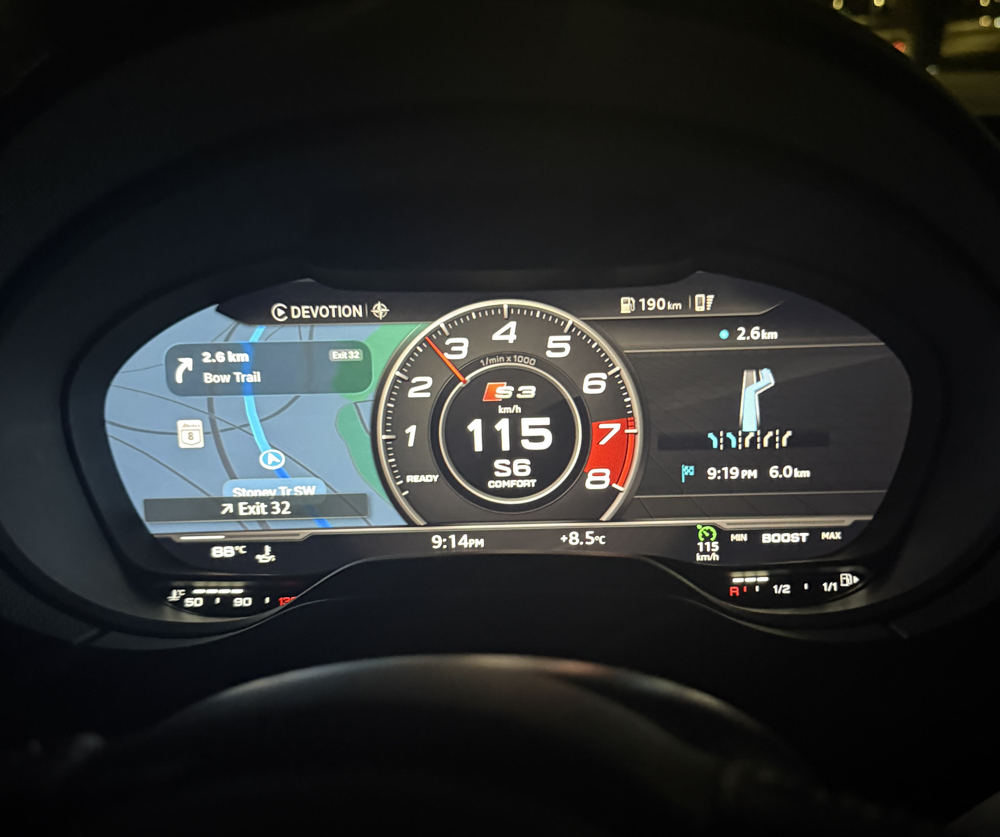

# Free CarPlay on the Virtual Cockpit: Audi A3 / S3 / RS3 (8V) MIB2 Guide

*Community guide for the 8V & 8Y Group (Audi A3/S3/RS3) Facebook group. Written by Jacob Lever based on a successful install on a 2017 Audi S3.*

> ⚠️ **Disclaimer:** Everything in this guide modifies your car's MMI head unit. A power loss, a bad SD card, or the wrong firmware file **can brick your MMI**. Nobody in this group, nor the authors of the tools below, is responsible for damage to your car. Read the whole guide before you start, and if anything doesn't match what you see on your screen, **stop and ask in the group.**

> 💸 **M.I.B. is free.** If anyone tries to sell you M.I.B. or these patches, you are being ripped off.

---

## Table of Contents

1. [What This Gets You](#1-what-this-gets-you)
2. [Prerequisites](#2-prerequisites)
3. [Step 1: Check Your Firmware Compatibility](#3-step-1-check-your-firmware-compatibility)
4. [Step 2: Update the MMI Firmware](#4-step-2-update-the-mmi-firmware)
5. [Step 3: Install M.I.B. and Patch the Unit](#5-step-3-install-mib-and-patch-the-unit)
6. [Step 4: Install the CarPlay Virtual Cockpit Module](#6-step-4-install-the-carplay-virtual-cockpit-module)
7. [Optional: Update the Virtual Cockpit Firmware](#7-optional-update-the-virtual-cockpit-firmware)
8. [Troubleshooting and Recovery](#8-troubleshooting-and-recovery)
9. [Resources and Credits](#9-resources-and-credits)

---

## 1. What This Gets You

At the end of this guide your car will have:

- **Patched MMI firmware** via M.I.B., which unlocks features (including CarPlay / Android Auto if your car didn't have them activated from the factory) and allows **unlimited free map updates** going forward.
- **CarPlay album art on the Virtual Cockpit** now-playing tile. Stock firmware sends the song title/artist/album to the cluster but never the cover picture.
- **MMI touchpad navigation in CarPlay.** Stock firmware supports the rotary knob, knob press, back and soft keys in CarPlay, but leaves the touchpad dead. This patch lets the touchpad act as a D-pad.



---

## 2. Prerequisites

Do not start until you have everything in this list.

### 🔴 A high-quality, FULL-SIZE SD card (critical)

This is the single most important item in this guide. **A bad SD card can brick your MMI unit.**

- ✅ Use a **genuine full-size SD card** from a reputable brand (SanDisk, Samsung, Kingston, Lexar), bought from a trustworthy retailer.
- ❌ **Do NOT use a microSD card in an adapter.**
- ❌ **Do NOT use cheap no-name / Amazon marketplace / AliExpress cards.** Counterfeit cards often report a fake capacity and corrupt data mid-write, which is exactly what you don't want during a firmware flash.
- Format the card as **FAT32** before each use and make sure the **write-protect switch is OFF**.
- Recommended size: **32 GB SDHC 120MB/s**

> 💡 Cards larger than 32 GB usually come formatted as exFAT. Windows & MAC won't format them as FAT32 natively, but there are tools online for download that can format larger cards **(I have no experience with these however, and cannot guarantee functionality)**. A 32 GB card avoids this hassle.

### 🔴 A proper battery charger / power supply (critical)

- **15 A minimum**, ideally a **constant-current / power-supply-mode** charger, **not a trickle charger or battery maintainer.**
- Some updates (especially the **map update**) can take **20 to 30+ minutes** with very large files. The ignition and MMI are on the whole time, and a voltage drop mid-flash can brick the unit.
- Short individual steps (like the CarPlay module install) don't strictly need the charger, but **if you're doing the updates back to back on the same day, a charger is essential.**
- **Do not run the engine during flashing.** The M.I.B. authors specifically advise against it.
- Recommended charger: **[MotoMaster Classic Series Wheeled Smart Battery Charger, Fully Automatic, 40/15/6-Amp](https://www.canadiantire.ca/en/pdp/motomaster-classic-series-wheeled-smart-battery-charger-fully-automatic-40-15-6-amp-12v-with-200-amp-engine-start-0111977p.html?rq=battery+charger+automotive)**
- This one is a bit overkill, so primarily just look for one with 15A charging capability with *limited* trickle/smart charging.

### Other things you'll need

- **A computer** to download files and prepare the SD card.
- **Your current SW train / firmware version** (see Step 1 below).
- **A diagnostic/coding tool** such as **VCDS, OBDeleven, or Car Scanner + OBD adapter**. You'll need this to:
  - Enable cover art on the Virtual Cockpit: module **17 (Instrument Cluster)** → adaptation **`Picture_Upload_Download`** → **Active**. Without this, the album art patch can't work.
- **Time and patience.** Budget **2–5 hours** if doing everything in one session.
- **mibsolution.one** (public login is `guest` / `guest`).

> ℹ️ **Note:** mibsolution.one sometimes has hosting outages. If the site is down, wait a day or two and try again. **Do not download firmware from random mirrors.**

---

## 3. Step 1: Check Your Firmware Compatibility

See Step 2 below for youtube link if you prefer visual instructions.

1. Find your **SW train** on the MMI. You can find it in the hidden red engineering service menu.
   - It will look something like `MHI2_US_AU37x_P4364`. Also note the **MU version** (e.g. `MU1326`).
2. Go to **[mib-helper.com](https://mib-helper.com/)** and enter your SW train in the box.
3. The tool will decode your firmware details and show you the latest available firmware, maps and activation methods for your unit.

### Which firmware should you be on?

The CarPlay Virtual Cockpit module has been **tested on a few different builds (see the github docs for more details)**

The following is **my firmware version** in which the Carplay and M.I.B libraries were installed on and verified to work.

| Property | Value |
| --- | --- |
| Train | `MHI2_US_AU37x_K5512_1` |
| MU | `MU1484` |
| Test car | 2017 Audi S3 8V.5 Sedan with Virtual Cockpit |

Other `MHI2_ER_AU37x_*` builds are **expected** to work but **not all are verified**. The safest path is to update to **`K5512_1`** before installing the CarPlay module.
> ℹ️ **Note:** At the time of my install, my software train was the **latest supported** train number for my Audi S3 8V which can be patched by M.I.B with **lifetime Audi maps key**. Other models may have slight varriance with this, so please due diligence if you are also looking to upgrade your native Audi maps.

> ⚠️ **If your SW train does NOT start with `MHI2_ER/US_AU37x`** (e.g. it's an MHI2Q / Qualcomm unit, or an MIB Standard "MST2" unit without navigation), **this guide is not for you.** Ask in the group before doing anything.

---

## 4. Step 2: Update the MMI Firmware

📺 **Video guide:** [Firmware update walkthrough](https://youtu.be/SeQCTiXJHVc)

**Summary of the process:**

1. Log in to **[mibsolution.one](https://mibsolution.one/)** (`guest` / `guest`).
2. Find and download the firmware for your unit. **folder path on mibsolution.one, e.g. MHI2 → Audi → MHI2_US_AU37x_K5512_1**
3. Format your SD card as FAT32 and extract the firmware to the **root** of the card.
4. **Connect the battery charger.** Turn the ignition on (engine off).
5. Insert the SD card into **SD slot 1 (SD1)**.
6. Open the **Red Engineering Menu**: **button combo, hold NAV/MAP button + MENU button** 
> ℹ️ **Tip**: Press the NAV/MAP button first then quickly also press the MENU button, holding both down until the red engineering menu appears
7. Select **Update → SD card** and choose the firmware, then follow the on-screen prompts.
8. **Do not touch anything** until the update finishes. The unit may restart several times.
9. Once finished, recheck your SW train (step 6) to confirm the new version.

> ℹ️ **Map update (optional):** **If you wish to update your Audi maps system this must be done AFTER installing M.I.B (Part 5) and patching the system. The map files are very large, so this is the step where the charger matters most.**

📺 **Video guide:** [Map update installation](https://youtu.be/zQfYfdSo8Ro)

---

## 5. Step 3: Install M.I.B. and Patch the Unit

📺 **Video guide:** [M.I.B. install and patch walkthrough](https://youtu.be/rzOmVFBbDNg)
📖 **Official docs:** [M.I.B. GitHub](https://github.com/Mr-MIBonk/M.I.B._More-Incredible-Bash) and [M.I.B. Wiki](https://github.com/Mr-MIBonk/M.I.B._More-Incredible-Bash/wiki)

M.I.B. (More Incredible Bash) is the toolkit that patches the MMI so it accepts feature activations and unlimited map updates. It runs inside the Green Engineering Menu (GEM).

### 5a. Prepare the M.I.B. SD card

1. Download the **latest M.I.B. release** from the [GitHub repo](https://github.com/Mr-MIBonk/M.I.B._More-Incredible-Bash) or mibsolution.one.
2. Format the SD card as **FAT32** (clean card, no leftover firmware files).
3. Extract **all** M.I.B. files to the **root** of the SD card.
4. Download the **pre-patched `ifs-root-stage2` image** for your exact firmware from **[mib.mibsolution.one](https://mib.mibsolution.one)**.
   - You only need the folder matching your train, e.g. `MHI2_US_AU37x_K5512_1_MU1484_PATCH`. **I have this patch file, so if you are having trouble finding it online, and you have the same software train as me please reach out and I will happily send it.**
5. Copy that folder into the **`/patches`** folder on the SD card. The files are already prepared, so don't rename anything.

### 5b. Install M.I.B. on the head unit

1. **Connect the battery charger**, ignition on, engine off.
2. Insert the SD card into **SD1**.
3. Open the **Red Engineering Menu** → **Update** → select the **SD card** → choose **"FREE for all - M.I.B. Launcher"** → **Start**.
4. The unit will **restart three times** during installation. **Let it finish.**
5. The Green Engineering Menu (GEM) is activated as part of the installation.

### 5c. Run the patch

1. Open the **Green Engineering Menu**: **hold NAV/MAP + RADIO buttons** in the same way as when accessing the Red engineering menu.
2. Select **`==>>m.i.b<<==`**.
3. Run a backup **BEFORE** patching (see [M.I.B. Docs](https://github.com/Mr-MIBonk/M.I.B._More-Incredible-Bash) for more details)
4. Once backup has finsihed adn you have restarted the MMI unit, run the **patch** function. **M.I.B → `patch_ifs_root_aio`**
4. Wait for the process to complete and the unit to reboot.
5. **Clear the SVM error** using the M.I.B. function or OBD11 (or other diagnostic tool)

> 🔑 **The SD card must stay in SD1 any time you want to use M.I.B. in the GEM.** No SD card, no M.I.B. menu.

> 💡 Keep this SD card. You'll reuse it for Step 4. If you ever want a newer M.I.B. version, you don't need to reinstall; just make a fresh SD card with the latest version.

---

## 6. Step 4: Install the CarPlay Virtual Cockpit Module

📖 **Official docs:** [mhi2-au37x-carplay GitHub](https://github.com/chefranov/mhi2-au37x-carplay)

This step is quick: usually **under a minute**.

### 6a. Prepare the SD card

1. Download the files from the [CarPlay GitHub repo](https://github.com/chefranov/mhi2-au37x-carplay). **[PLACEHOLDER: confirm whether you used the green "Code → Download ZIP" button or a release package]**
2. Insert your **M.I.B. SD card** into your computer.
3. Open the **`mod`** folder. **Do NOT delete or overwrite the other files already in this folder.**
4. Lay out the files exactly like this:

```
/mod/custom.sh                       <- copy of custom.sh & other folders/files from the repo package
/mod/carplay/install.sh
/mod/carplay/uninstall.sh
/mod/carplay/bin/coverart_hook.jar
/mod/carplay/bin/dpad_hook.jar
/mod/carplay/bin/libcarplay_hook.so
```

> ⚠️ **If a `custom.sh` already exists in your `mod` folder**, replace it with the new one, there was not one for me by default.

### 6b. Run the install

1. Insert the SD card into **SD1**, ignition on.
2. Open the **Green Engineering Menu** → **`==>>m.i.b<<==`** → **Advanced Settings** → **Run Custom Script**.
3. The script finds the files, installs them, and prints what it did. This usually takes **less than a minute.**
4. **Wait a moment** before rebooting so the files finish writing. Rebooting immediately can leave a file truncated.
5. **Reboot the MMI**: **[PLACEHOLDER: e.g. hold the MMI power knob for ~10 seconds]**

### 6c. Enable Album art file transfer

- Make sure module **17** adaptation **`Picture_Upload_Download`** is set to **Active** (see Prerequisites). Without this, the album art won't show.

### 6d. Test it

1. Plug in your iPhone and start CarPlay.
2. Play a song that has album art. It should appear on the Virtual Cockpit's now-playing tile.
3. Try swiping on the MMI touchpad to move around CarPlay menus (only if you have touchpad).

### Uninstalling

Follow the github docs.

---

## 7. Optional: Update the Virtual Cockpit Firmware

📺 **Video guide:** [Virtual Cockpit firmware update](https://youtu.be/Lp-EzfGiPyA)

> ⚠️ **Not yet tested** This can be done at any point in the process.

**More details coming soon, I am waiting to do this myself.**

---

## 8. Troubleshooting and Recovery

| Problem | What to try |
| --- | --- |
| mibsolution.one is down | It has occasional hosting issues. Wait a day or two. Don't use random mirrors. |
| No album art on the Virtual Cockpit | Confirm module 17 `Picture_Upload_Download` is **Active**. Confirm you rebooted the MMI after installing. |
| CarPlay patch installed but nothing changed | You may have rebooted too quickly and a file was truncated. Run the custom script again, wait, then reboot. |
| M.I.B. doesn't show in the GEM | The M.I.B. SD card must be in **SD1**. |
| MMI unit gets stuck during boot after the CarPlay install | See recovery below. |
| Carplay maps no longer appear in VC, but turn-by-turn directions till appear from carplay | Holding the steering wheel middle scroll wheel for 2-3 seconds switches between OEM maps and Carplay map. **The choice is preserved even after car power cycle**|

### Recovery if the MMI doesn't start after the CarPlay install

The CarPlay patch replaces some stock system classes. If your firmware differs from the tested build, the MMI interface may fail to load. The good news is that it's reversible:

- The repo author notes that **telnet on port 23 still works** even when the screen doesn't come up. Deleting the two `.jar` files returns the MMI to stock.
- This requires a **USB-to-Ethernet adapter** and some comfort with a command line. If you're not comfortable with this, **ask in the group before attempting it.** Full instructions are in the [Recovery section of the CarPlay GitHub](https://github.com/chefranov/mhi2-au37x-carplay#recovery).

---

## 9. Resources and Credits

| Resource | Link |
| --- | --- |
| MIB-Helper (firmware checker) | https://mib-helper.com/ |
| M.I.B. GitHub | https://github.com/Mr-MIBonk/M.I.B._More-Incredible-Bash |
| M.I.B. Wiki | https://github.com/Mr-MIBonk/M.I.B._More-Incredible-Bash/wiki |
| MIB Wiki | https://mibwiki.one |
| mibsolution.one (firmware / patches) | https://mibsolution.one/ (login: `guest` / `guest`) |
| CarPlay Virtual Cockpit module | https://github.com/chefranov/mhi2-au37x-carplay |
| Video: Firmware update | https://youtu.be/SeQCTiXJHVc |
| Video: M.I.B. install and patch | https://youtu.be/rzOmVFBbDNg |
| Video: Virtual Cockpit firmware | https://youtu.be/Lp-EzfGiPyA |

**Huge thanks** to Mr-MIBonk and the M.I.B. team, chefranov for the CarPlay module, the creators of the videos above, and the wider MIB community for making all of this free.

*Last updated: October 28th, 2026 · Questions? Post in the group and tag Jacob Lever.*
